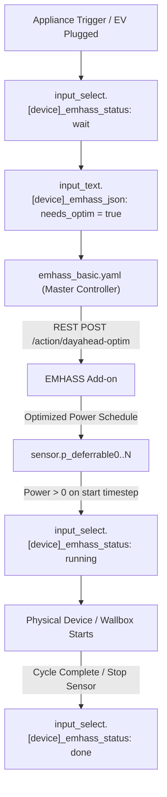

# EMHASS Development & Architecture Guide

This skill documents the complete EMHASS setup, blueprint architectures, deferrable load state machines, go-eCharger EV charging logic, and battery optimization controllers in Home Assistant.

---

## 1. EMHASS Core Architecture & Optimization Config

- **Add-on Service:** Docker container managed by Supervisor (`slug: 5b918bf2_emhass`, REST port 5000).
- **Optimization Strategy:**
  - `costfun`: Set to `cost` (minimizes total monetary cost).
  - Feed-in Tariff (`production_price`): `0.082` €/kWh (fixed German EEG feed-in remuneration).
  - Dynamic Import Tariff: Tibber electricity price (`sensor.tibber_electricity_price`).
  - Solcast Solar Forecast: Real-time 48h irradiance forecast passed to EMHASS via `sensor.solcast_pv_forecast_prognose_aktuelle_stunde` and future timesteps.

---

## 2. Blueprint System & JSON Protocol

The system utilizes three core blueprints to decouple scheduling from physical hardware:



### JSON Helper Payload Schema (`input_text.[device]_emhass_json`)
```json
{
  "po": 11000,    // Nominal power in Watts (W)
  "ho": 2.5,      // Operating hours required (h)
  "st": 0,        // Earliest start timestep index (0 = now)
  "et": 96,       // Latest finish timestep index (96 = 24h at 15m steps)
  "se": false,    // Semi-continuous load (bool)
  "si": true,     // Single constant power block (bool)
  "mp": 4200,     // Minimum power in Watts (W)
  "pe": 2,        // Startup penalty score
  "us": "wait",   // Automation status (done, wait, running, force)
  "ss": 0         // Actual planned start timestamp (0 = no plan yet)
}
```

---

## 3. go-eCharger Wallbox: PV Surplus vs. EMHASS Grid Scheduling

The go-eCharger controller (`examples/blueprints/emhass_basic_trigger_go_echarger_blueprint.yaml` / `automation.emhass_deferrable_load_controller_for_go_echarger`) dynamically determines whether to use pure PV surplus charging or EMHASS cost-optimized grid charging:

### Logic Distinction by Season (`goe_pv_surplus_enabled`):
- **Summer (May to September):**
  - When sun is above horizon (`sun.sun == 'above_horizon'`), surplus charging is enabled (`true`).
  - Sets go-eCharger to Mode 4 (eco/surplus), charging dynamically with available solar power.
- **Transition & Winter (October to April):**
  - Surplus charging is enabled **only** if the remaining Solcast daily forecast covers the entire EV charge demand:
    ```jinja2
    
    
    
      {{ false }}
    
      {{ true }}
    
      
      
      {{ needed_kwh > 0 and remaining_pv_kwh >= needed_kwh }}
    
    ```
  - **Deficit Situation (e.g. 40.5 kWh needed vs 14.5 kWh forecast):**
    Surplus mode evaluates to `false`. Status stays `wait`. EMHASS optimizes charging during cheap night hours via `p_deferrable4`.

### Key Wallbox Sensors:
- `binary_sensor.goe_297534_car_0`: Car connected to wallbox (`on` / `off`).
- `sensor.vr3ezzkxzpj688123_batterie`: EV battery SoC (%).
- `sensor.emhass_go_echarger_trigger`: Calculated gross energy needed in Wh (95% target SoC, 92.5% charging efficiency).

---

## 4. Battery Storage & SoC Management

### Kostal Min SoC Controller (`examples/automation/kostal_min_soc_controller.yaml`)
- Dynamically manages minimum SoC of the home storage battery based on season and daily Solcast forecast:
  - **Daytime with high solar forecast:** Lowers min SoC (e.g. 10%) so battery can be fully utilized.
  - **Overcast winter / Night:** Raises min SoC (e.g. 15-20%) to maintain emergency reserve and reduce cyclic stress.

### EMHASS PV Battery Status Controller (`examples/automation/emhass_pv_battery_status_controller.yaml`)
- Interprets EMHASS `sensor.p_batt_forecast` to manage home battery charging and discharging.
- **Strict Grid Charging Safety Condition:**
  Grid charging is strictly restricted to prevent false triggers during daytime PV surplus:
  ```jinja2
  {{ (p_batt < -500) and (p_grid > (p_load + 500)) }}
  ```
  Only when EMHASS plans active battery charging from grid during cheap tariff windows does the controller switch the battery into grid-charge mode.
