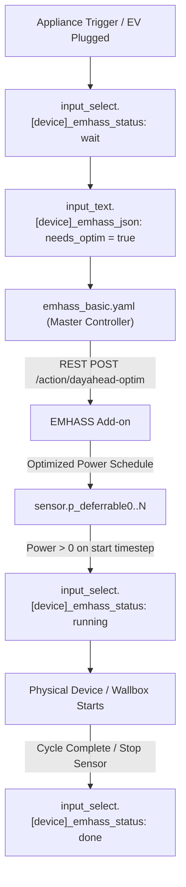

# EMHASS Development & Architecture Guide

This skill documents the complete EMHASS setup, blueprint architectures, deferrable load state machines, go-eCharger EV charging logic, and battery optimization controllers in Home Assistant.

---

## 1. EMHASS Core Architecture & Optimization Config

- **Add-on Service:** Docker container managed by Supervisor (`slug: 5b918bf2_emhass`, REST port 5000).
- **Diagnostic & Dry-Run API Endpoints (EMHASS ≥v0.18.7):**
  - `POST /api/v1/dry-run/<action>` (e.g., `/api/v1/dry-run/dayahead-optim`): Solves and returns the optimization plan directly without writing any files or updating Home Assistant entities (`feat: dry run: POST /api/v1/dry-run/<action> solves and returns the plan, writing nothing`). Useful for troubleshooting, reproducing infeasibility, or testing runtime payloads without side effects.
  - `GET /api/v1/plan` & `GET /api/v1/last-run`: Structured JSON inspection of the latest optimization run.
- **Optimization Strategy:**
  - `costfun`: Set to `cost` (minimizes total monetary cost).
  - Feed-in Tariff (`production_price`): `0.082` €/kWh (fixed German EEG feed-in remuneration).
  - Dynamic Import Tariff: Tibber electricity price (`sensor.tibber_electricity_price`).
  - Solcast Solar Forecast: Real-time 48h irradiance forecast passed to EMHASS via `sensor.solcast_pv_forecast_prognose_aktuelle_stunde` and future timesteps.
  - **Dynamic DST Horizon & ML Forecaster Lags (`emhass_basic.yaml`)**:
    - Because EMHASS calculates its optimization horizon in calendar days (`pd.date_range(start, end=start + DateOffset(days=1))`), the 24h window contains `96` steps on normal days, `100` steps (25 hours) on autumn Daylight Saving Time (DST) fall-back transitions, and `92` steps (23 hours) on spring DST transitions.
    - The blueprint dynamically computes `emhass_config_horizon_steps` (matching EMHASS `utils.get_forecast_dates`) and automatically slices or pads `load_cost_forecast` and `p_pv_forecast` (which are generated with up to `100` steps in the input templates) to the exact required length (`92`, `96`, or `100`).
    - For `mlforecaster`, `num_lags` is set to `((1440 * delta_days + 60) / step_minutes) | int` (`100` for 15-minute steps) so `forecast-model-fit` always trains enough lag features to cover a 25-hour fall-back day without throwing `IndexError: list index out of range`.

---

## 2. Blueprint System & JSON Protocol

The system utilizes three core blueprints to decouple scheduling from physical hardware:



### JSON Helper Payload Schema (`input_text.[device]_emhass_json`)
```json
{
  "po": 11000,    // Nominal power in Watts (W)
  "ho": 2.5,      // Operating hours required (h)
  "st": 0,        // Earliest start timestep index (0 = now)
  "et": 96,       // Latest finish timestep index (96 = 24h at 15m steps)
  "se": false,    // Semi-continuous load (bool)
  "si": true,     // Single constant power block (bool)
  "mp": 4200,     // Minimum power in Watts (W)
  "pe": 2,        // Startup penalty score
  "us": "wait",   // Automation status (done, wait, running, surplus, force)
  "ss": 0         // Actual planned start timestamp (0 = no plan yet)
}
```

---

## 3. go-eCharger Wallbox: PV Surplus vs. EMHASS Grid Scheduling

The go-eCharger controller (`examples/blueprints/emhass_basic_trigger_go_echarger_blueprint.yaml` / `automation.emhass_deferrable_load_controller_for_go_echarger`) dynamically determines whether to use pure PV surplus charging or EMHASS cost-optimized grid charging:

### Logic Distinction by Season (`goe_pv_surplus_enabled`):
- **Summer (May to September):**
  - When sun is above horizon (`sun.sun == 'above_horizon'`), surplus charging is enabled (`true`).
  - Sets go-eCharger to Mode 4 (eco/surplus), charging dynamically with available solar power.
- **Transition & Winter (October to April):**
  - Surplus charging is enabled **only** if the remaining Solcast daily forecast covers the entire EV charge demand:
    ```jinja2
    
    
    
      {{ false }}
    
      {{ true }}
    
      
      
      {{ needed_kwh > 0 and remaining_pv_kwh >= needed_kwh }}
    
    ```
  - **Deficit Situation (e.g. 40.5 kWh needed vs 14.5 kWh forecast):**
    Surplus mode evaluates to `false`. Status stays `wait`. EMHASS optimizes charging during cheap night hours via `p_deferrable4`.

### Priority, State Machine & Active Charging Control Loop:
- **State Grouping Variables (`force_states`, `surplus_states`, `running_states`)**:
  Both `emhass_basic_trigger.yaml` and `emhass_basic_trigger_go_echarger.yaml` define top-level list variables (`force_states`, `surplus_states`, `running_states`) to keep the blueprints diff-identical across shared state transitions:
  - `force_states`: `['force', 'force-6', 'force-10', 'force-12', 'force-14', 'force-16']`
  - `surplus_states`: `['surplus']`
  - `running_states`: `['running'] + surplus_states + force_states`
- **Strict State Machine Transition Rules (`1320` State Transition Guard)**:
  Both trigger blueprints enforce strict automatic state transitions:
  - **Allowed transitions**: `done -> wait`, `wait -> running`, `running -> force*`, `wait -> surplus`, `surplus -> force*`, `running -> done`, `surplus -> done`, `force* -> done`, `done -> surplus`, and `* -> done`.
  - **Forbidden automatic transitions**: `running -> surplus`, `surplus -> running`, `running -> wait`, `surplus -> wait`. Once an appliance or EV enters `running` or `surplus`, it stays locked in that state until it finishes (`done`) or is upgraded to `force*`.
- **Interruptible vs. Non-Interruptible Loads (`emhass_basic_trigger.yaml`)**:
  - **Non-interruptible (`si: true`, e.g., Dishwasher)**: Stays in `running` with switch `on` until `stop_sensor` drops below threshold (`trigger_strategy: "1"`).
  - **Interruptible (`si: false`, `trigger_strategy: "5"`, e.g., Water Boiler)**: Stays in `running` across multiple EMHASS blocks while `sum(p_deferrable) > 0`, but dynamically pauses the physical switch (`pause_interruptible_switch` -> `value_switch: "off"`) during intermediate 0 W timesteps and turns it back `on` when `p_deferrable > 0`.
- **Active Charging Control Loop (`emhass_basic_trigger_go_echarger.yaml`)**:
  Runs while the EV is connected and charging (`st in running_states`):
  1. **Full Charge Detection:** When `sensor.emhass_go_echarger_trigger < 10` Wh (target SoC reached), stops charging (`frc = 1`), disables surplus (`fup = off`), sets status and JSON to `done`, and exits the loop.
  2. **Force Mode (`st in force_states`):** Guarantees charging to 100% full at 16A (or selected `force-X` current). Never interrupted by zero EMHASS power.
  3. **EMHASS Basic Mode (Mode 3, `running`):** When `st == 'running'` and `p_deferrable4 > 0`, modulates current ($A = \text{clamp}(\lceil P / 690 \rceil, 6, 16)$) with `frc = 2`, `lmo = 3`, and `fup = off`. If `p_deferrable4 == 0` while `running` (multi-block wait), pauses charging (`frc = 1`) while staying in `running`.
  4. **Surplus Eco Mode (Mode 4, `surplus`):** When `st in surplus_states`, sets Mode 4 at 16A with `fup = on`, and continuously streams `set_pv_data` (grid, pv, battery). If surplus conditions end (`goe_pv_surplus_enabled == false`), pauses (`frc = 1`, `fup = off`) while staying in `surplus`.
  5. **Disconnection Cleanup:** When the EV is unplugged, automatically sets `frc = 1`, `fup = off`, and marks status `done`.

### Key Wallbox Sensors:
- `binary_sensor.goe_297534_car_0`: Car connected to wallbox (`on` / `off`).
- `sensor.vr3ezzkxzpj688123_batterie`: EV battery SoC (%).
- `sensor.emhass_go_echarger_trigger`: Calculated gross energy needed in Wh (95% target SoC, 92.5% charging efficiency).

---

## 4. Battery Storage & SoC Management

### Kostal Plenticore Sensor Quirk: Real PV vs. Total Inverter DC Power
- **Hardware Quirk:** On Kostal Plenticore inverters with a high-voltage battery connected to DC3, `sensor.scb_solar_power` reports total inverter DC power:
  $$\text{Power} = \text{DC1} + \text{DC2} + \text{Battery Discharge (DC3)}$$
- **Critical Rule:** Never use `sensor.scb_solar_power` to determine available solar generation during battery discharge. It causes a runaway positive feedback loop where battery discharge into the car is misidentified as solar surplus.
- **Actual Solar Generation Calculation:**
  ```jinja2
  {{ (states('sensor.scb_dc1_power') | float(0.0)) + (states('sensor.scb_dc2_power') | float(0.0)) }}
  ```

### Physical Battery Constraints & True 1:1 SoC Mapping
- **Hardware Minimum Floor (10%):** The Kostal BYD/home battery system has a physical hardware floor at 10% to prevent deep discharge degradation. It cannot discharge below 10%.
- **EMHASS Parameter Configuration:**
  - `emhass_config_battery_minimum_state_of_charge` must be set to `0.10` (10%). Never configure it to lower values (such as `0.05`), as that causes the LP solver to schedule unachievable discharges.
  - `emhass_config_soc_init`: Must use the direct 1:1 physical battery SoC:
    ```jinja2
    {{ (states('sensor.scb_battery_soc') | float(10) / 100) | round(2) }}
    ```
    Artificial compression or linear shifting (e.g., `(soc - 20) / 80`) must NOT be used, as it misrepresents actual available energy to the LP solver (falsely indicating an empty battery at 20% or only 19% at 35%).
  - `emhass_config_soc_final`: Uses fixed time-window minimums (`night_soc = 0.3` for 20:00–10:00, `first_half_day_soc = 0.5` for 10:00–16:00, `second_half_day_soc = 0.4` for 16:00–20:00) combined with `[current_soc, min_soc] | max`. If the current battery SoC exceeds the window's minimum, EMHASS must restore at least `current_soc` by the end of the 24h horizon, preventing net battery depletion when EV charging is scheduled overnight and incentivizing grid charging during cheap tariff windows when solar forecast is insufficient.

### Battery Recovery Hysteresis (10% ↔ 20%)
To protect the battery cells and avoid rapid cycling around the emergency reserve floor, the Kostal controller implements stateful hysteresis:
1. **Floor Reached ($\le 10\%$):** When battery SoC drops to $\le 10\%$, recovery mode activates. `base_min_soc` immediately steps up from 10% to 20%.
2. **Discharge Prevention During Recharge ($10\% < \text{SoC} \le 20\%$):** The inverter's `number.scb_battery_min_soc` remains at 20%. Any solar charging is retained; household load peaks or EV charging cannot discharge the battery back to 10%.
3. **Recovery Exit ($> 20\%$):** Once battery SoC rises above 20% (e.g., 21%), recovery mode deactivates and `base_min_soc` returns to 10%.
4. **State Machine Formulation (no extra helper needed):**
   ```jinja2
   current_soc: "{{ states('sensor.scb_battery_soc') | int(10) }}"
   current_min_setting: "{{ states('number.scb_battery_min_soc') | int(10) }}"
   is_battery_recovering: >-
     {{ current_soc <= 10 or (current_min_setting >= 20 and current_soc <= 20) }}
   base_min_soc: >-
     {{ 20 if (current_soc <= 10 or (current_min_setting >= 20 and current_soc <= 20)) else 10 }}
   ```

### Kostal Min SoC Controller (`examples/automation/kostal_min_soc_controller.yaml`)
Dynamically controls `number.scb_battery_min_soc` and coordinates with EMHASS and Wallbox modes. All calculations enforce ceiling rounding to 5% steps (`ceil(soc / 5) * 5`) clamped to `[base_min_soc, 90]`:
- **Case 1: Battery Grid Charging (`input_select.pv_battery_emhass_status` in `running`, `force`)**:
  - Sets `scb_battery_min_soc` to `emhass_calc_soc` (forecast SoC from `sensor.soc_batt_forecast`, rounded up to 5% steps and clamped between `base_min_soc` and 90%).
- **Case 2: EV Charging at Wallbox (`input_select.wallbox_emhass_status` active)**:
  - **Subcase 2a: PV Surplus Mode (`select.goe_297534_lmo == '4'`)**:
    - If real PV ($DC1+DC2 \ge 1500\text{ W}$) **and** Solcast remaining forecast $\ge 3.0\text{ kWh}$: Allows battery buffering down to `wallbox_allowed_min_soc` (`base_min_soc`, i.e., 20% if recovering, 10% otherwise).
    - Otherwise (cloudy/evening): Protects home battery by locking `scb_battery_min_soc` to `protect_soc` (`[base_min_soc, current_soc] | max`, rounded up to 5% steps).
  - **Subcase 2b: EMHASS Scheduled Charging / Grid Mode (`select.goe_297534_lmo != '4'`)**:
    - Aligns directly with EMHASS's global cost-optimal schedule.
    - Sets `scb_battery_min_soc` to `emhass_calc_soc` (`sensor.soc_batt_forecast`, rounded up to 5% steps). Kostal will cover any minor planned battery assistance, but will never drain the battery below the forecast level, reserving home battery capacity for expensive peak hours.
- **Default (Idle)**:
  - When neither grid charging nor Wallbox is active, resets `scb_battery_min_soc` to `base_min_soc` (10%, or 20% if recovering) and ensures `select.battery_charging_usage_mode` is `None`.

### EMHASS PV Battery Status Controller (`examples/automation/emhass_pv_battery_status_controller.yaml`)
- Interprets EMHASS `sensor.p_batt_forecast` to manage home battery charging and discharging.
- **Strict Grid Charging Safety Condition:**
  Grid charging is strictly restricted to prevent false triggers during daytime PV surplus:
  ```jinja2
  {{ (p_batt < -500) and (p_grid > (p_load + 500)) }}
  ```
  Only when EMHASS plans active battery charging from grid during cheap tariff windows does the controller switch the battery into grid-charge mode.
