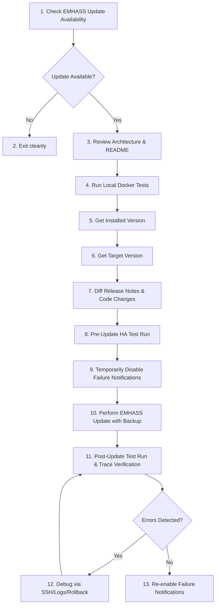

# EMHASS Add-on Update Workflow

This skill provides a safe, reproducible, and verified update process for the Home Assistant EMHASS add-on (`5b918bf2_emhass` / `update.emhass_update`). It prevents service outages, API breaking changes, false-positive error notification storms, and configuration incompatibilities.

---

## 1. Architecture & Context

Before updating, review the component architecture (see [README.md](../../../README.md)):
- **EMHASS Add-on:** Runs as a container under Home Assistant Supervisor (`slug: 5b918bf2_emhass`, REST API default port `5000`).
- **Central Controller (`emhass_basic.yaml`):** Manages optimizations (`naive-mpc-optim`, `dayahead-optim`), sensor publishing (`publish-data`), and configuration persistence (`set-config`).
- **Satellite Load Triggers (`emhass_basic_trigger.yaml`, `emhass_basic_trigger_go_echarger.yaml`):** Calculate dynamic parameters for deferrable loads and feed them to the central controller.
- **Local Test Suite (`tests/run_tests.ps1`):** Simulates Home Assistant and EMHASS inside a Docker container to catch template and logic regressions prior to deployment.

---

## 2. The 13-Step Update Workflow



---

### Step 1 & 2: Check Update Availability
Check via the Home Assistant MCP server whether an update is available for the EMHASS add-on:

```json
// Tool: ha_manage_updates
{
  "action": "list"
}
```
Or directly for the specific entity:
```json
// Tool: ha_manage_updates
{
  "action": "get",
  "entity_ids": ["update.emhass_update"]
}
```
- **Exit Condition:** If `installed_version == latest_version` or `update_available == false`, terminate the workflow with an informative message ("No update required").

---

### Step 3: Review Architecture & Project Structure
Review [README.md](../../../README.md) and confirm:
- Which deferrable loads are configured (`trigger_objs`).
- Which blueprint files (`blueprints/automation/emhass_basic.yaml`, `emhass_basic_trigger.yaml`, `emhass_basic_trigger_go_echarger.yaml`) are active.
- Target blueprint paths on the live system (`/config/blueprints/automation/`).

---

### Step 4: Verify Docker Daemon & Execute Local Tests
Before touching the live environment, verify that all local unit and regression tests pass:

1. **Check Docker Daemon:**
   ```powershell
   docker info --format '{{.ServerVersion}}'
   ```
   *(Note: On Windows with Docker Desktop WSL2 backend, `Get-Service com.docker.service` may report `Stopped`. Always rely on `docker info`.)*

2. **Run Test Suite:**
   ```powershell
   powershell -File tests/run_tests.ps1
   ```
   All test cases in [tests/test_emhass_basic.py](../../../tests/test_emhass_basic.py) and [tests/test_multi_load.py](../../../tests/test_multi_load.py) must pass (`PASSED`).

---

### Step 5 & 6: Inspect Installed & Target Versions
Inspect and record version information:
```json
// Tool: ha_get_app
{
  "source": "installed"
}
```
Find the app slug `5b918bf2_emhass`:
- **Installed Version:** e.g. `v0.17.6`
- **Target Version:** e.g. `v0.18.5`

---

### Step 7: Analyze Release Notes & Code Breaking Changes
Fetch release notes directly from Home Assistant:
```json
// Tool: ha_manage_updates
{
  "action": "get",
  "entity_ids": ["update.emhass_update"],
  "include_release_notes": true
}
```

> [!WARNING]
> **Critical EMHASS Breaking Change Patterns:**
> 1. **REST API HTTP Status Codes:**
>    - In older releases (e.g. `v0.17.6`), action endpoints (`naive-mpc-optim`, `dayahead-optim`, `publish-data`) returned HTTP `201 Created`.
>    - Starting in `v0.17.7+`, successful actions return HTTP `200 OK`.
>    - Verify that [blueprints/automation/emhass_basic.yaml](../../../blueprints/automation/emhass_basic.yaml) checks `response.status not in [200, 201]` instead of `response.status != 201` to prevent false failure alerts!
> 2. **New Parameters in `config_defaults.json`:**
>    - The blueprint `Save` action (`result_data.save`) calls `/set-config`. If parameters introduced in newer EMHASS versions are omitted or array lengths mismatch, configuration saves or optimizations fail.
>    - Compare upstream GitHub tags (`davidusb-geek/emhass`):
>      - `src/emhass/data/config_defaults.json`
>      - `src/emhass/utils.py` (specifically `DEF_LOAD_ARRAY_PARAMS`)
>    - All new deferrable load parameters must be padded with `([default] * (trigger_objs | length))`.
> 3. **Blueprint Synchronization:**
>    - When local blueprint files are modified, always ensure the local Git repository and Home Assistant are kept identical.
>    - **Preferred Method (via ha_mcp):**
>      Use `ha_manage_blueprints` to save the updated blueprint directly to Home Assistant. This automatically creates an edit snapshot backup and reloads all automations using the blueprint:
>      ```json
>      // Tool: ha_manage_blueprints
>      {
>        "action": "save",
>        "domain": "automation",
>        "path": "emhass_basic.yaml",
>        "overwrite": true,
>        "yaml": "<full content of local blueprints/automation/emhass_basic.yaml>"
>      }
>      ```
>    - **SSH Context:**
>      Connecting via SSH uses the host alias `ssh homeassistant` (from local `~/.ssh/config`). Note that SSH sessions run under standard user permissions without root privileges, so writing directly to `/config/blueprints/` via SSH is blocked by file ownership. Thus, `ha_manage_blueprints` via the MCP server is the canonical synchronization method.

---

### Step 8: Pre-Update Test Run in Home Assistant
Execute a manual verification run against the currently installed version before upgrading.

1. **Verify Automation Configuration:**
   ```json
   // Tool: ha_config_get_automation
   {
     "identifier": "automation.emhass_basic_automation"
   }
   ```
   Ensure `automation_started_manually` is set to `"all"` (so that manual triggers execute the full sequence: Save, Optim, Publish). If set to `"log"`, temporarily update it to `"all"` via `ha_config_set_automation`.

2. **Trigger Automation Manually:**
   ```json
   // Tool: ha_call_service
   {
     "domain": "automation",
     "service": "trigger",
     "target": {
       "entity_id": "automation.emhass_basic_automation"
     }
   }
   ```

3. **Verify Execution:**
   - Check automation trace:
     ```json
     // Tool: ha_get_automation_traces
     {
       "automation_id": "automation.emhass_basic_automation",
       "limit": 1
     }
     ```
     Verify: `state == "stopped"`, `script_execution == "finished"`, no `error`.
   - Check add-on logs:
     ```json
     // Tool: ha_get_logs
     {
       "source": "supervisor",
       "slug": "5b918bf2_emhass"
     }
     ```

---

### Step 9: Temporarily Disable Failure Notifications
To prevent notification noise (e.g. mobile push, Telegram) while the add-on container restarts or encounters transient errors during the update:

1. Retrieve current automation config:
   ```json
   // Tool: ha_config_get_automation
   {
     "identifier": "automation.emhass_basic_automation"
   }
   ```
2. Set `enable_optim_failure_notification: false`:
   ```json
   // Tool: ha_config_set_automation
   {
     "identifier": "automation.emhass_basic_automation",
     "config_hash": "<current_hash>",
     "action": "update",
     "automation_config": {
       "use_blueprint": {
         "input": {
           "enable_optim_failure_notification": false
         }
       }
     }
   }
   ```

---

### Step 10: Perform EMHASS Update with Backup
Trigger the update via Supervisor and **explicitly mandate a backup**:

```json
// Tool: ha_manage_updates
{
  "action": "install",
  "entity_ids": ["update.emhass_update"],
  "backup": true
}
```

> [!IMPORTANT]
> **Verify Backup Creation:**
> Check that a backup containing the prior version was created using `ha_manage_backup(action="list")`.

Wait until the EMHASS container completes its startup:
```json
// Tool: ha_get_app
{
  "source": "installed"
}
```
Verify that `5b918bf2_emhass` reports state `started` and the new version string.

---

### Step 11: Post-Update Test Run & Trace Verification
Execute a comprehensive test run following the update:

1. **Trigger Automation Manually:**
   ```json
   // Tool: ha_call_service
   {
     "domain": "automation",
     "service": "trigger",
     "target": {
       "entity_id": "automation.emhass_basic_automation"
     }
   }
   ```
2. **Inspect Automation Traces in Detail:**
   ```json
   // Tool: ha_get_automation_traces
   {
     "automation_id": "automation.emhass_basic_automation",
     "limit": 1
   }
   ```
   Retrieve detailed step results with the latest `run_id`:
   ```json
   // Tool: ha_get_automation_traces
   {
     "automation_id": "automation.emhass_basic_automation",
     "run_id": "<run_id>",
     "sections": "actions,error"
   }
   ```
   Verify inside `action_trace`:
   - All `rest_command` calls (`Save`, `Optimization`, `Publish`) completed with status `200` (or `201`).
   - The failure condition `action/2/repeat/sequence/1/if` evaluated to `result: false`.

3. **Check Supervisor Add-on Logs:**
   ```json
   // Tool: ha_get_logs
   {
     "source": "supervisor",
     "slug": "5b918bf2_emhass"
   }
   ```
   Confirm absence of Python tracebacks (`KeyError`, `ValueError`, `500 Internal Server Error`).

---

### Step 12: Debugging & Remediation (If Errors Occur)
If issues are detected during Step 11:

1. **SSH Diagnostics:**
   Query container logs directly on Home Assistant:
   ```powershell
   ssh homeassistant "docker logs addon_5b918bf2_emhass --tail 100"
   ```
2. **Inspect Saved Config:**
   ```powershell
   ssh homeassistant "cat /share/config.json"
   ```
3. **Deploy Blueprint Fixes:**
   If new payload fields or status code adjustments are needed:
   - Fix locally in `blueprints/automation/emhass_basic.yaml`.
   - Run local tests: `powershell -File tests/run_tests.ps1`.
   - Deploy to Home Assistant:
     ```powershell
     Get-Content -Raw -Encoding UTF8 blueprints/automation/emhass_basic.yaml | ssh homeassistant "cat > /config/blueprints/automation/emhass_basic.yaml"
     ```
   - Reload automations: `ha_call_service(domain="automation", service="reload")`.
4. **Emergency Rollback (if necessary):**
   If an unfixable upstream bug is encountered, restore the prior backup:
   ```json
   // Tool: ha_manage_backup
   {
     "action": "restore",
     "slug": "<backup_slug>"
   }
   ```

---

### Step 13: Re-enable Notifications & Restore Initial State
Once the post-update test run passes cleanly, restore the production configuration:

1. Fetch latest config hash via `ha_config_get_automation`.
2. Re-enable failure notifications:
   ```json
   // Tool: ha_config_set_automation
   {
     "identifier": "automation.emhass_basic_automation",
     "config_hash": "<current_hash>",
     "action": "update",
     "automation_config": {
       "use_blueprint": {
         "input": {
           "enable_optim_failure_notification": true
         }
       }
     }
   }
   ```
3. If `automation_started_manually` was altered before Step 8, restore its original value (e.g. `"log"` or `"all"`).

---

## 3. Test Extensions & Best Practices

1. **Payload Key Validation Tests:**
   In [tests/test_emhass_basic.py](../../../tests/test_emhass_basic.py), maintain a test case that validates all keys in `result_data.save` against the current `config_defaults.json`.
2. **HTTP Status Code Tolerance:**
   Treat both HTTP 200 and 201 as valid success states:
   ```yaml
   value_template: "{{ (context | from_json).automation.notify_enabled | bool and response.status not in [200, 201] }}"
   ```
3. **Automated Git Commit:**
   Following a successful update and any blueprint adjustments, commit and tag the changes:
   ```powershell
   git status
   git add blueprints/ .agents/skills/
   git commit -m "chore(emhass): update to <target_version> and adjust blueprint compatibility"
   ```
