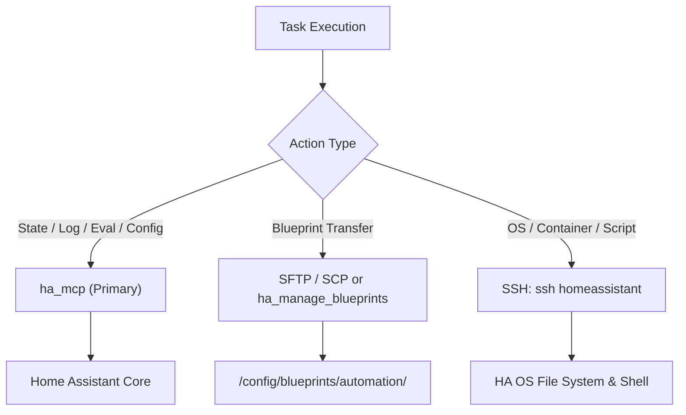

# Home Assistant Development Guide

This skill documents the development architecture, tool access hierarchy, testing conventions, and deployment workflows for this repository and its connected Home Assistant environment.

---

## 1. Repository Architecture & Layout

This repository serves as the single source of truth for all Home Assistant custom automations, blueprints, dashboard packages, and tests:

| Directory | Purpose |
| :--- | :--- |
| `blueprints/automation/` | Master automation blueprints (e.g. `emhass_basic.yaml`, `emhass_basic_trigger.yaml`, `emhass_basic_trigger_go_echarger.yaml`). |
| `examples/automation/` | Reusable standalone automations (e.g. `kostal_min_soc_controller.yaml`, `emhass_pv_battery_status_controller.yaml`, `ha_database_purge.yaml`). |
| `examples/blueprints/` | Tested blueprint configurations and input payloads. |
| `examples/sensors/` | Custom template sensors and trigger calculation configurations. |
| `dashboards/` | Lovelace YAML dashboard configurations and custom view cards. |
| `tests/` | Unit tests (`test_emhass_basic.py`, `test_multi_load.py`), scenarios (`tests/scenarios/`), and mocks. |
| `tools/` | Automated utility scripts executed via SSH (e.g. `ha_system_health.py`). |
| `.agents/skills/` | Agent skills for automated, token-efficient workflows. |

---

## 2. Tool Priority & Access Hierarchy

Always follow this order when inspecting, testing, or updating Home Assistant:



1. **`ha_mcp` (Preferred Tool)**:
   - Always prioritize `ha_mcp` over SSH for all live entity states, Jinja2 template testing (`ha_eval_template`), log review (`ha_get_logs`), system health (`ha_get_system_health`), and configuration of automations, scripts, helpers, and scenes.
2. **Blueprint Deployment**:
   - Transfer blueprint YAML files via SFTP/SCP or `ha_manage_blueprints`.
   - *Note*: The standard `admin` user on Home Assistant OS has restricted write permissions on `/config/blueprints/` over standard SSH, requiring SFTP or MCP tools.
3. **SSH Access (`ssh homeassistant`)**:
   - The SSH host alias `homeassistant` is pre-configured on the development workstation in `~/.ssh/config`.
   - Use SSH for host OS diagnostics, container inspection, filesystem checks, and executing diagnostic scripts (`tools/run_system_health.ps1`).

---

## 3. Container-First Local Testing

To ensure full reproducibility and effortless migration between PCs:
- **Always run tests in Docker**: Never rely on host-installed Python dependencies.
- **Verification**: Ensure Docker engine is active (`docker info`).
- **Execution**: Run the test runner:
  ```powershell
  .\tests\run_tests.ps1
  ```
- **TDD Workflow**: When fixing bugs or modifying blueprint logic:
  1. Add/modify a scenario in `tests/scenarios/` that reproduces the bug.
  2. Verify that the test fails inside Docker.
  3. Implement the fix and confirm that all tests pass.

---

## 4. Git Commit Standards (Focus on "WHY")

- **Focus on the "WHY"**: Commit messages must explain **why** a change was necessary (motivation, root cause, problem solved), not just **what** lines changed.
- **Language**: English only.
- **Conventional Commits**: Use `feat:`, `fix:`, `refactor:`, `docs:`, `chore:`.
- **Example**:
  - *Good*: `fix(wallbox): prevent winter grid charging by verifying solar forecast exceeds EV requirement`
  - *Bad*: `update goe template in blueprint`

---

## 5. Skill Maintenance Lifecycle

- **Always In Sync**: Whenever blueprint inputs, entity names, automation architectures, or API versions change, update corresponding skills in `.agents/skills/` immediately.
- **Token Efficiency**: Optimize skill instructions to keep future agent context small and focused.
