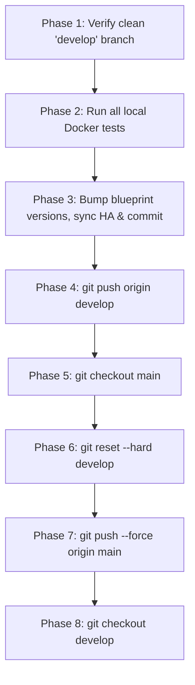

# Publish Release (`develop` → `main`)

This skill executes a structured, 8-phase release workflow that validates the repository state, runs all local Docker tests, versions modified automation blueprints, synchronizes them to Home Assistant, pushes `develop`, and publishes the release to `main` via `git reset --hard`.

> [!IMPORTANT]
> **Mandatory Step-by-Step Confirmation**: You **MUST** pause and ask the user for explicit confirmation before executing the actions in each phase. Never chain multiple phases automatically without user approval.

---

## Workflow Overview



---

## Phase 1: Verify Local `develop` Branch Status

1. Check the active Git branch and working tree status:
   ```powershell
   git branch --show-current
   git status --porcelain
   ```
2. **Validation Rules**:
   - If the current branch is **not** `develop`, or if `git status --porcelain` returns any uncommitted/untracked changes, **abort immediately** and inform the user which files are uncommitted or which branch is currently active.
   - If the branch is `develop` and the working tree is completely clean, report the status to the user and ask for confirmation to proceed to **Phase 2**.

---

## Phase 2: Run All Local Tests (Docker)

1. Verify that the Docker engine is running and execute the full test suite inside the container:
   ```powershell
   docker info --format '{{.ServerVersion}}'
   .\tests\run_tests.ps1
   ```
2. **Validation Rules**:
   - If Docker is unavailable or any test fails, **abort the release immediately** and report the failure details to the user.
   - If all tests pass (`0 failed`), present the test summary to the user and ask for confirmation to proceed to **Phase 3**.

---

## Phase 3: Update Blueprint Versions (`blueprints/automation/`)

1. **Identify Changed Blueprints**:
   Compare `main` and `develop` to find all YAML blueprints modified since the last release:
   ```powershell
   git diff --name-only main..develop -- blueprints/automation/*.yaml
   ```
   *(If no blueprint YAML files changed between `main` and `develop`, inform the user and ask whether to skip version bumping or manually select files, then ask for confirmation to proceed to Phase 4).*

2. **Calculate Target Version String**:
   Determine the current year and month (`YYYYMM`, e.g., `202610` for October 2026).
   For each modified blueprint in `blueprints/automation/*.yaml`, inspect the version tag at the end of `blueprint.name` (e.g., `(v202605)` or `(v202605-1)`) and the `variables.blueprint_version` field:
   - **Case A — Existing base version is older than current `vYYYYMM`** (e.g., `v202605` when current month is `202610`):
     - New version: `vYYYYMM` (e.g., `v202610`).
   - **Case B — Existing base version already matches `vYYYYMM` without a patch suffix** (e.g., `v202610`):
     - Append `-1` → `vYYYYMM-1` (e.g., `v202610-1`).
   - **Case C — Existing version already has a patch suffix for current `vYYYYMM`** (e.g., `v202610-1` or `v202610-2`) **or is from a future month tag that matches**:
     - Increment the patch number by `+1` → `vYYYYMM-(N+1)` (e.g., `v202610-2`).
     *(Note: If an existing version has a newer `YYYYMM` than the current calendar month, e.g., `v202611`, preserve its `YYYYMM` and append/increment `-1` so versions never go backwards).*

3. **Present Proposed Version Changes & Confirm**:
   Show the user a summary table of the affected files, their old version, and the new target version:
   | Blueprint File | Old Version | New Version |
   | :--- | :--- | :--- |
   | `blueprints/automation/...` | `v...` | `v...` |

   Ask the user for confirmation before applying the changes.

4. **Apply Changes, Sync to Home Assistant & Commit**:
   Once confirmed:
   - Update both `name: ... (v...)` (line 2) and `blueprint_version: v...` (under `variables:`) in each affected file.
   - Synchronize each updated blueprint to Home Assistant using `ha_manage_blueprints`:
     ```json
     {
       "action": "save",
       "domain": "automation",
       "path": "<filename>.yaml",
       "overwrite": true,
       "yaml": "<full updated YAML content>"
     }
     ```
   - Stage and commit the version bump on `develop`:
     ```powershell
     git add blueprints/automation/*.yaml
     git commit -m "chore(blueprints): bump modified blueprint versions to <version> for main release"
     ```
   - Report the commit hash and HA sync status, then ask for confirmation to proceed to **Phase 4**.

---

## Phase 4: Push `develop` to Remote

1. Ask the user for confirmation to push `develop` to `origin`.
2. Upon confirmation, run:
   ```powershell
   git push origin develop
   ```
3. Report the push output and ask for confirmation to proceed to **Phase 5**.

---

## Phase 5: Checkout `main` Branch

1. Ask the user for confirmation to switch from `develop` to `main`.
2. Upon confirmation, run:
   ```powershell
   git checkout main
   ```
3. Verify the active branch is `main` and ask for confirmation to proceed to **Phase 6**.

---

## Phase 6: Hard Reset `main` to `develop`

1. Show the current commit of `main` vs `develop` (`git rev-parse --short main develop`) and ask the user for confirmation to execute `git reset --hard develop` on `main`.
2. Upon confirmation, run:
   ```powershell
   git reset --hard develop
   ```
3. Verify `HEAD` now matches `develop` and ask for confirmation to proceed to **Phase 7**.

---

## Phase 7: Force Push `main` to Remote

1. Ask the user for explicit confirmation to force-push `main` to `origin` (`git push --force origin main`).
2. Upon confirmation, run:
   ```powershell
   git push --force origin main
   ```
3. Report the push result and ask for confirmation to proceed to **Phase 8**.

---

## Phase 8: Checkout `develop` Branch

1. Ask the user for confirmation to switch back to the `develop` branch.
2. Upon confirmation, run:
   ```powershell
   git checkout develop
   ```
3. Verify `git branch --show-current` is `develop` and `git status` is clean, then present a final release summary.
